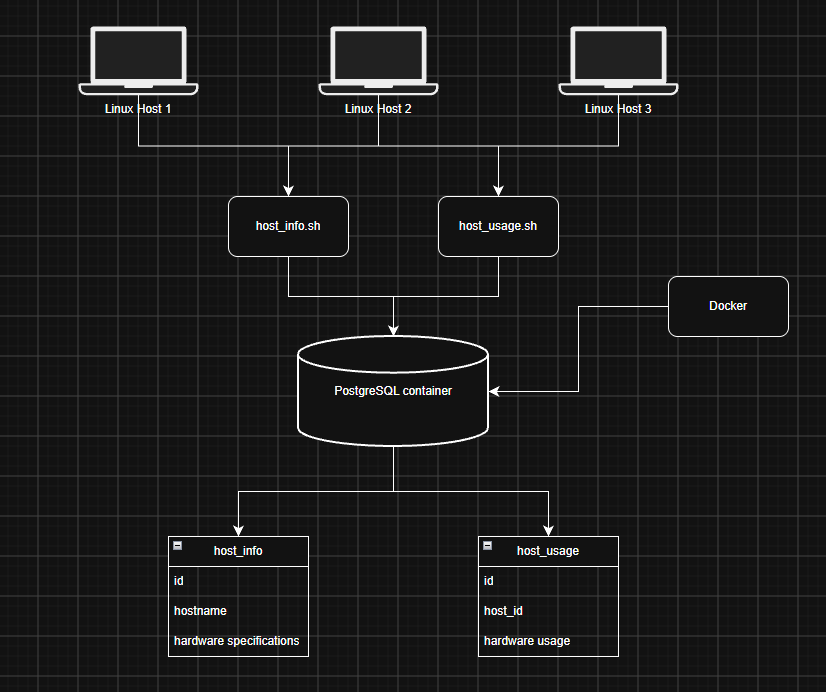

# Linux - Cluster Monitoring

## Introduction

Linux cluster monitoring is a backend application built on Linux created to collect the user's resource usage information in preset intervals. 

The application is built using Linux as its operating environment, PostgreSQL for persistent database storage, Crontab for its automatic program scheduling, Docker for lightweight containerization, and Bash scripts to automate hardware data collection.

## Features

- PostgreSQL database integration for persistent data storage
- Automated database table creation
- Automated Docker container setup and management
- Automated collection and insertion of system information
- Background execution of monitoring scripts
- Scheduled data collection without manual intervention
  
## Technologies Used

- Linux
- Docker
- PostgreSQL
- Bash
- Crontab
- Git

## Quick Start

### Prerequisites

- Linux OS
- Docker
- PostgreSQL
- Git

### Setup

Clone the repository

```bash
git clone https://github.com/jarviscanada/jarvis_data_eng_KevaunHarris
```

Navigate into the Linux directory

```bash
cd jarvis_data_eng_KevaunHarris/linux_sql
```

Create and manage your PostgreSQL Docker container

```bash
./scripts/psql_docker.sh start|stop|create [db_username][db_password]
```

Create your PostgreSQL database

```bash
psql -h localhost -U postgres -W
CREATE DATABASE host_agent;
```

Exit PostgreSQL

```bash
\q
```

Create database tables
```bash
psql -h localhost -U postgres -d host_agent -f sql/ddl.sql
```

Collect and insert your hardware specifications into the database

```bash
# Fill in the respective information to match your own
./scripts/host_info.sh [psql_host] [psql_port] [db_name] [psql_user] [psql_password]
```

Automate resource usage collection

```bash
crontab -e
# Enter the location for your host_usage.sh script
* * * * * bash [location] [psql_host] [psql_port] [db_name] [psql_user] [psql_password] > /tmp/host_usage.log
```

## Implementation

### Hardware Information Collection

The `host_info.sh` script uses Linux commands to retrieve hardware specifications from your machine such as `lscpu` and `date`.

The information is then truncated and searched using commands such as `awk`, `grep`, and `xargs` before being inserted into the PostgreSQL database.

### Resource Usage Collection

The `host_usage.sh` script gathers information on resource usage using commands such as `vmstat` and `df`.

### Database Integration

Bash scripts use PostgreSQL to establish database connections and execute queries.

The collected information is inserted into the respective database tables for persistent storage.

## Architecture



## Scripts

| Script | Arguments |  Description |
| :---: | :---: | :---: |
| ddl.sql | None | Creates the template tables for data input |
| psql_docker.sh | Stop Create Start, DB User, DB Password | Manages the PostgreSQL Docker container |
| host_info.sh | PSQL Host, PSQL Port, DB Name, PSQL User, PSQL Password | Inputs host hardware specification data into the host_info table of the specified database |
| host_usage.sh | PSQL Host, PSQL Port, DB Name, PSQL User, PSQL Password | Inputs host usage information into the host_usage table of the specified database |

## Database Modelling

The database `host_data` consists of two tables, `host_info` and `host_usage`. The former stores hardware-specific information while the latter contains resource usage.


### host_info

| Id | Hostname | CPU Number | CPU Architecture | CPU Model | CPU Mhz | L2 Cache | Timestamp | Total Memory |
| :---: | :---: | :---: | :---: | :---: | :---: | :---: | :---: | :---: |
| 1 | User | 1 | x86_64 | Intel(R) Xeon(R) CPU @ 2.30GHz | 2300 | 256 | 2019-05-29 17:49:53.000 | 601324 |

### host_usage

| Timestamp | Host ID | Memory Free | CPU Idle | CPU Kernel | Disk I/O | Disk Available |
| :---: | :---: | :---: | :---: | :---: | :---: | :---: |
| 2019-05-29 15:00:00.000 | 1 | 300000 | 90 | 4 | 2 | 3 |


## Testing

The application was tested by executing individual Bash scripts and verifying PostgreSQL database information.

### Docker
- Verify the PostgreSQL is container created successfully.
- Verify the user can connect to the container.
- Verify the user can be stopped and started.

### Database
- Verify the table template creation is automated.
- Verify that the hardware specification is in the host info table.
- Verify the host usage table has a foreign key in the host usage table.
- Verify user resource usage is in the host usage table.


### Scripts
- Verify the `host_info.sh` script collects and inserts the hardware specification data.
- Verify the `host_usage.sh` script collects the resource usage and inserts it into the correct table.

### Automation
- Verify that crontab executes the `host_usage.sh` script.
- Verify the new records are inserted into the table.
- Verify the logs are created post to entry.


## Deployment

### Docker & PostgreSQL

PostgreSQL is deployed using Docker. The "psql_docker.sh" script is used to create, stop, and start the container with the corresponding image.

### Data Collection

The `host_info.sh` script collects hardware specifications from the Linux host and inserts the information into the `host_info` table.

The `host_usage.sh` script collects system resource usage, including CPU utilization, memory availability, and disk usage. The collected information is then inserted into the `host_usage` table.

### Automation 

Crontab is used to execute the automation of the bash script directly in Linux. It causes the "host_usage.sh" script to run over a set interval, allowing the system to collect data  without user intervention. The logs are then directed to `/tmp/host_usage.log` for monitoring.

## Improvements
- Implement automatic scans for changes in hardware and update the host_info  table accordingly.
- Add a visual representation of data usage for set periods of time.
- Support for multiple hosts within a single cluster.


